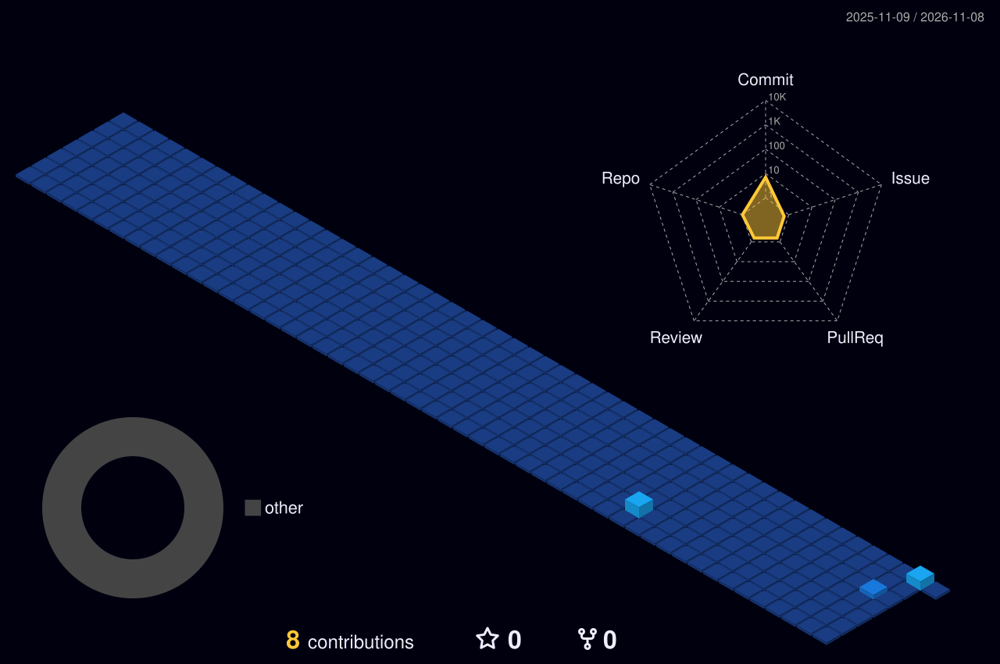

<h1 align="center">Welcome to Jhonata Angelo's Hub</h1>

<b>Software Developer</b> · Explorando projetos open source, web e dados

---

## 🧑‍💻 Perfil

<table>
<tr>
<td width="35%" valign="top">

<h3>Jhonata Angelo</h3>
<b>@jhonataangelo892-hub</b>  

  

  
📍 Brasil 
🧑‍💻 Desenvolvedor de software com foco em desenvolvimento web e dados 
👥 Seguidores abaixo · Contribuições em atividade
</td>
<td width="65%" valign="top">

### 📊 Visão geral

</td>
</tr>
</table>

---

## 🛠️ Core Technologies

---

## 📈 Estatísticas & Linguagens

---

## 🐍 Contribution Snake

---

## 🌐 Conecte-se comigo

<!-- ⚠️ QUANDO CRIAR SEUS PRIMEIROS PROJETOS, descomente e preencha esta seção:

## 🗂️ Notable Projects

-->
